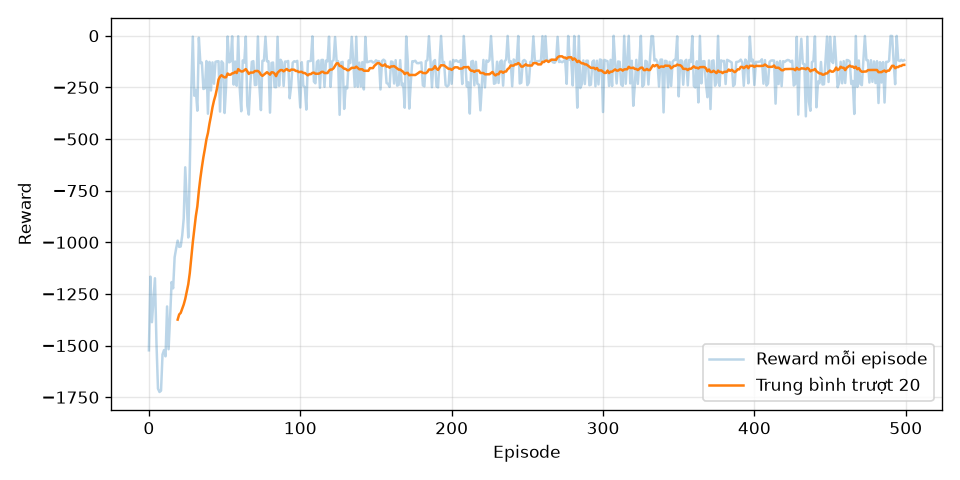

# DDPG trên Pendulum-v1

Cài đặt DDPG (Lillicrap et al., 2015) từ đầu bằng PyTorch, không dùng thư viện RL.

## Bài toán
Pendulum-v1: con lắc ngược, hành động là mô-men xoắn liên tục trong [-2, 2].
Không gian hành động liên tục nên Q-learning không áp dụng được — không thể argmax
trên vô hạn giá trị.

## Thành phần
- `buffer.py` — replay buffer, mảng numpy cấp phát sẵn với con trỏ quay vòng
- `networks.py` — Actor (state → action, tanh × max_action) và Critic (state+action → Q)
- `ddpg.py` — agent: target networks, soft update (τ=0.005), hàm update
- `train.py` — vòng huấn luyện, exploration bằng nhiễu Gaussian
- `watch.py` — chạy chính sách đã học, có render

## Siêu tham số
γ=0.99, τ=0.005, lr_actor=1e-4, lr_critic=1e-3, batch=256, buffer=1e6, 500 episode.

## Kết quả
Reward từ -1791 ở episode đầu, hội tụ quanh -120 sau khoảng 30 episode.
Benchmark công khai cho DDPG trên Pendulum là -150 đến -200.

Chính sách đã học vung con lắc lên trong một lần và giữ gần thẳng đứng, lệch khoảng 5°.
Độ lệch này là điểm cân bằng của hàm reward: phạt cả góc lệch lẫn lực dùng, nên
chỉnh hoàn hảo tốn nhiều hơn phần thưởng thu được.